# Kiln user guide

A walk through the control panel, page by page, and the things people usually want to do with it. For
installing Kiln and the `.env` settings, see the [README](../README.md) and
[CONFIGURATION.md](CONFIGURATION.md). If something doesn't work, see
[TROUBLESHOOTING.md](TROUBLESHOOTING.md).

> The screenshots show a demo instance. The model names come from real Hugging Face repositories, but the requests, speeds,
> tuning results and GPU readings are sample data made up to show the layout. They are not benchmarks.

**Contents**

- [Your first ten minutes](#your-first-ten-minutes)
- [Getting around](#getting-around)
- [Overview](#overview)
- [Server](#server)
- [Presets](#presets)
- [Models](#models)
- [Tuner](#tuner)
- [Requests](#requests)
- [Settings](#settings)
- [Browser extension](#browser-extension)
- [Recipes](#recipes)

## Your first ten minutes

Kiln has two ports. The **control panel** (`http://<host>:8090`) is what this guide describes. The **API**
(`http://<host>:8080/v1`) is where your tools send requests. Everything goes through Kiln's API port, so
every client is counted on the dashboard.

1. **Get a model.** Open **Models**, paste a Hugging Face ID such as `unsloth/Qwen3-8B-GGUF:Q4_K_M`, pick the file and
   download it. Models you already have under `MODELS_DIR` show up in the library on their own.
2. **Make a preset.** In the library, press the **+** on the model's row. Kiln opens the preset editor with
   sensible defaults (`-ngl 99 -fa on -c 16384 -np 1 --jinja` for a chat model) and the model's name as the preset name. Rename it if you like, and save.
3. **Start it.** On **Presets**, press the play button, or choose the preset on **Server** and press **Start**.
   Kiln checks that it fits in GPU memory first.
4. **Send a request.** Point any OpenAI-compatible client at `http://<host>:8080/v1`:

   ```bash
   curl http://localhost:8080/v1/chat/completions -H 'Content-Type: application/json' -d '{
     "model": "my-preset",
     "messages": [{"role": "user", "content": "Say hello in five words."}]
   }'
   ```

   `model` is the preset's **API name** (its alias, or its name if you left the alias empty). A name that
   matches nothing goes to the chat model used last, so existing clients keep working.
5. **Watch it.** The **Overview** page fills in after the first completion.

## Getting around

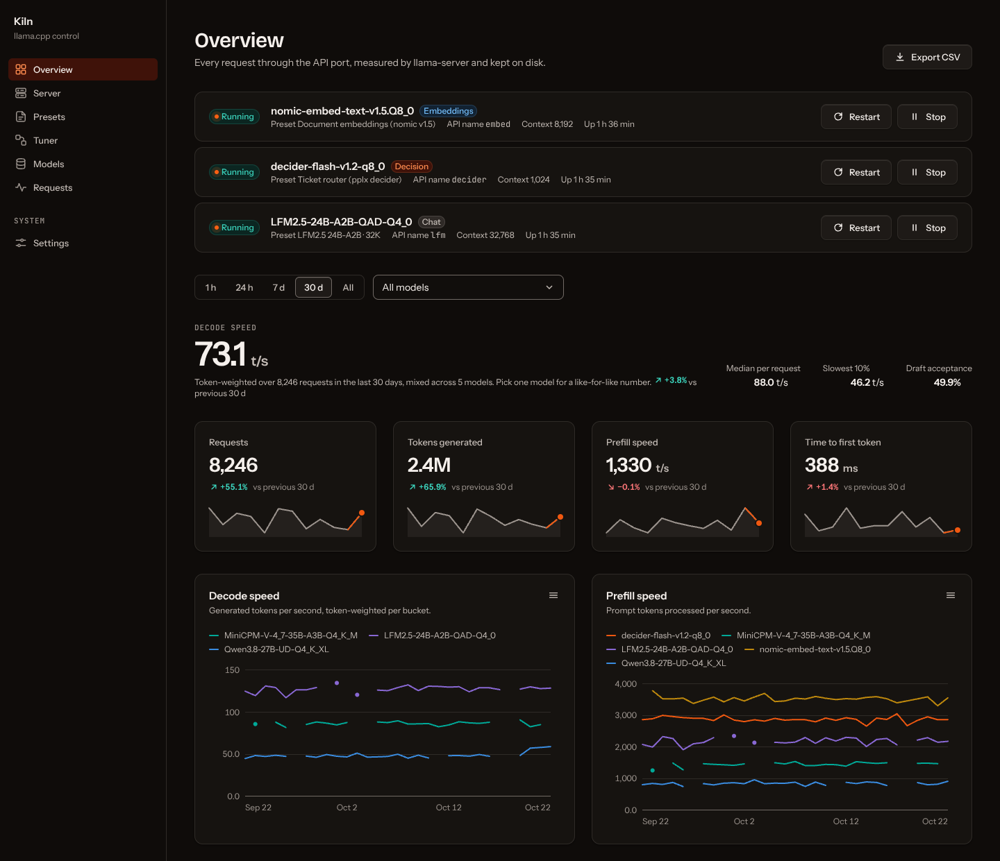

- **The side navigation** has the six working pages and **Settings**. Pages are addressed by the part of
  the URL after `#`, such as `#/server` or `#/tuner`, so you can bookmark them.
- **The status block** at the bottom of the navigation shows whether a model is running. With several
  models running it lists each by API name, with a dot that is lit while that model is ready.
- **Theme.** The sun/moon button beside the status switches between dark and light. The choice is remembered
  in your browser.
- **Notifications.** Things that finish or break while you are looking elsewhere show as toasts, and as
  desktop notifications when the tab is hidden and your browser has given permission (Kiln asks the first
  time you start a tuning run). They cover: tuning finished, failed or cancelled; downloads finished or failed
  (with a **Retry** button); a model becoming ready, failing to load or crashing; a model unloaded for being idle;
  and the live connection dropping and coming back.
- **Phones.** Below 960 px the navigation becomes a menu button and the layouts stack.

  <table>
    <tr>
      <td>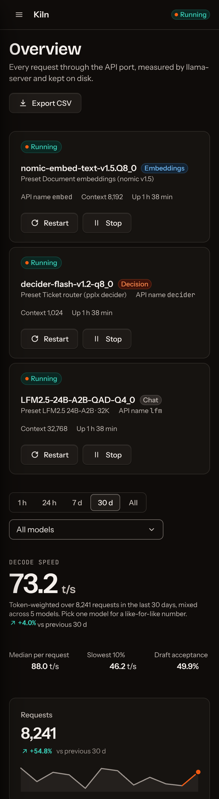</td>
      <td>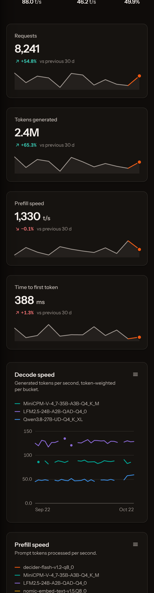</td>
    </tr>
  </table>

- **Light theme:**

  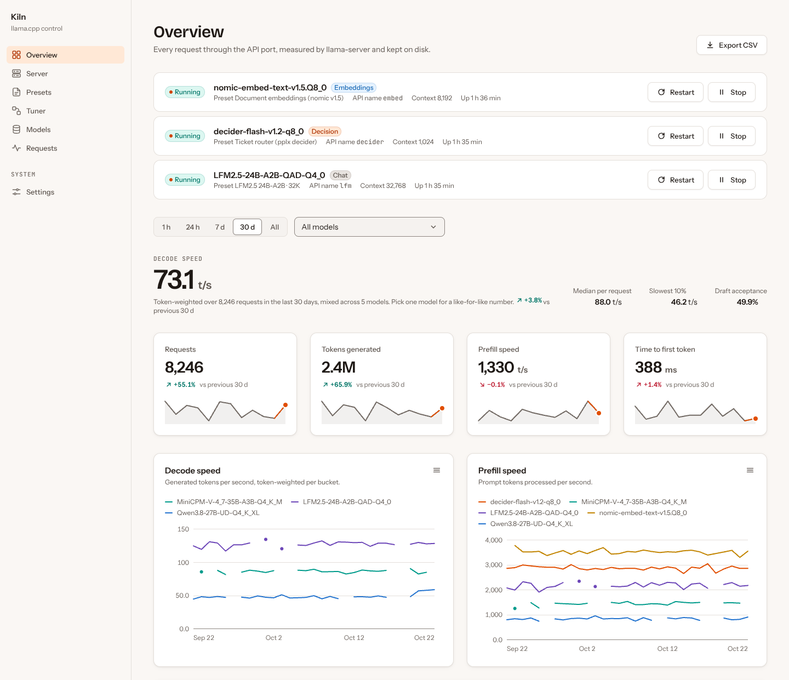

## Overview

Every request through the API port, measured by llama-server and kept in the database.

**Live strip.** One row per running model: state, model file, preset, API name, context size and uptime,
with **Restart** and **Stop**. With nothing loaded, a **Start server** button takes you to the Server page.

**Filters.** The range (1 h, 24 h, 7 d, 30 d, All) and the model. When several models have been used, Kiln
starts with the running model selected so the headline number is like-for-like. Choose **All models** to mix them.

**Decode speed** is the headline number: generated tokens per second, *token-weighted* (total tokens divided by
total generation time), so a two-token reply counts for less than a two-thousand-token one. Beside it:

| Figure | Meaning |
|---|---|
| Median per request | The middle per-request decode rate. |
| Slowest 10% | The rate that 90% of requests beat. |
| Draft acceptance | Share of drafted tokens the model accepted, when speculative decoding is on. |

Per-request rates skip generations shorter than 8 tokens, which are too noisy to mean anything. The change
shown next to the number compares with the previous period of the same length.

**Stat cards.** Requests, tokens generated, prefill speed and median time to first token, each with its change
against the previous period and a small trend line. *Time to first token* is the first content event for
streaming requests; for others it is wall time minus decode time, plus one token. Time spent waiting for a model
to be loaded is kept out of it and shown separately.

**Charts.** Each chart has a menu button that switches it to a table.

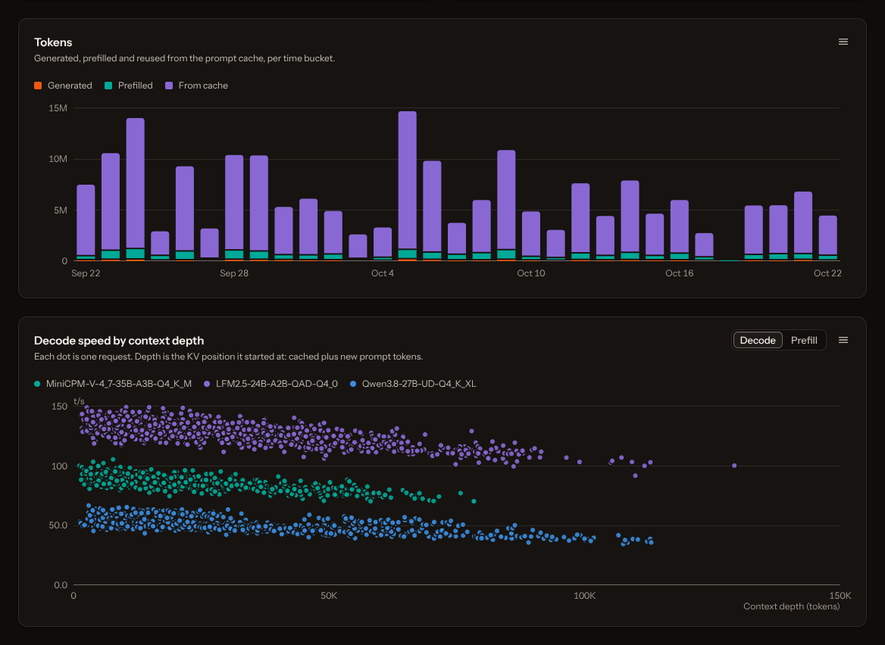

- *Decode speed* and *Prefill speed*, one line per model, never on a shared axis.
- *Tokens* per time bucket: generated, prefilled, and reused from the prompt cache.
- *Decode (or prefill) speed by context depth*: each dot is one request. Depth is where the request started in the
  KV cache, cached plus new prompt tokens. This is the quickest way to see how much a model slows down as the
  conversation grows.

**Below the charts:** a per-model table, the last eight requests, a live GPU card (VRAM, busy, power, junction
temperature, and ten minutes of history) and **All-time totals**, which ignore the filter.

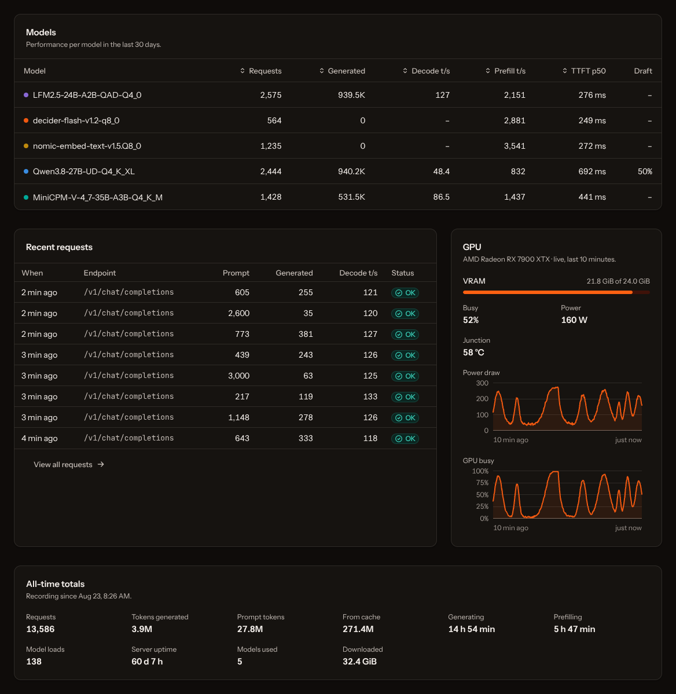

The GPU card reads AMD cards from `/sys/class/drm` and NVIDIA cards with `nvidia-smi`. Without a readable GPU it
says so, and Kiln can't check whether another model fits.

**Export CSV** (top right) downloads the requests in the current range and model.

## Server

The running models, what is left of GPU memory, how to start another, the exact command, and the log.

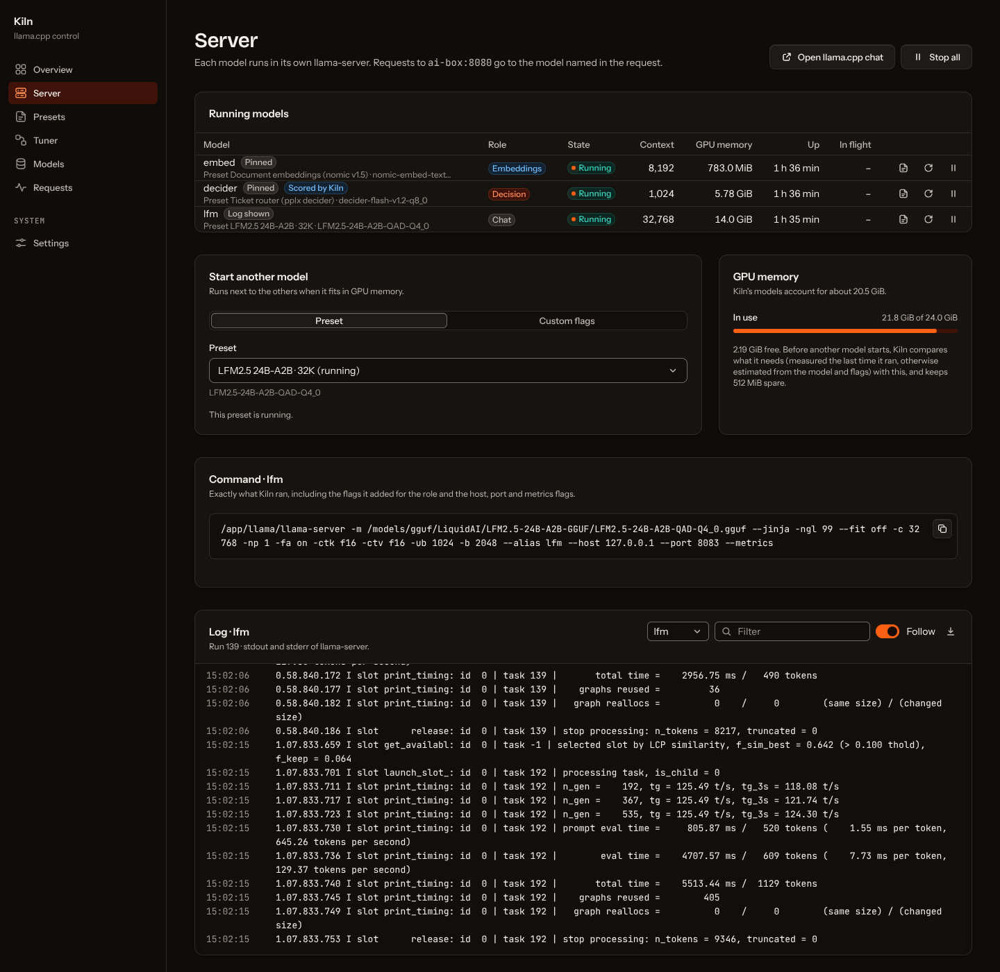

**Running models.** For each model: its role, state, context size, **GPU memory** and uptime.
GPU memory is *measured* the first time a model loads on its own and shown plainly; until then it is an
estimate and shown with a `~`. The three buttons are *show its log*, *restart* and *stop*. Badges tell you a
model is **Pinned** (never stopped to make room), **Scored by Kiln** (a Perplexity decision model that Kiln
scores itself), or that its **Log** is the one shown below.

**Stop all** stops every model. **Open llama.cpp chat** opens llama.cpp's own chat page on the API port.

**Start another model.** Pick a preset, or switch to **Custom flags** to give a model file and a flag line
without saving anything. Before it starts, Kiln estimates what the model needs from its header and your flags,
and compares that with the VRAM that is free right now, keeping 512 MiB spare. The note under the preset tells you
what it found:

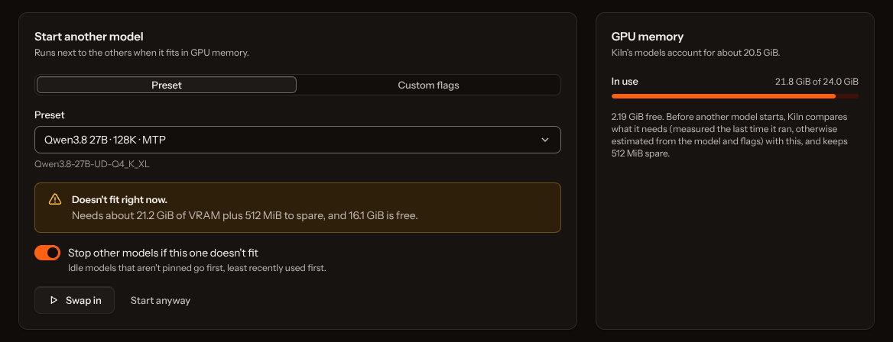

- *Fits next to what's running* shows the estimate, whether it is measured or estimated, and what is free.
- *Doesn't fit right now* says by how much. With **Stop other models if this one doesn't fit** on, idle models that
  aren't pinned are stopped first, least recently used first, and the button reads **Swap in**.
  **Start anyway** skips the check.

How the estimate works, and how it compares with real measurements, is in
[Running several models](MULTI-MODEL.md#routing-fit-and-swapping).

**Command** shows exactly what Kiln ran, including the flags it added for the role and its own `--host`,
`--port` and `--metrics`. Notes list anything Kiln changed. **Log** is the live output of llama-server for the
selected model, with a filter, a **Follow** switch and a download button. **Run history** lists the last 25 runs:
how long each took to load, its context and GPU memory, how long it ran and how it ended (Running, Stopped,
Crashed or Interrupted), each with its full log.

If a model exits unexpectedly, a red banner shows the last error line and stays until you **Dismiss** it or
start the model again. While the tuner is running, a banner says it has the GPU.

## Presets

A preset is a model plus the flags and environment to run it with, a role, and an API name.

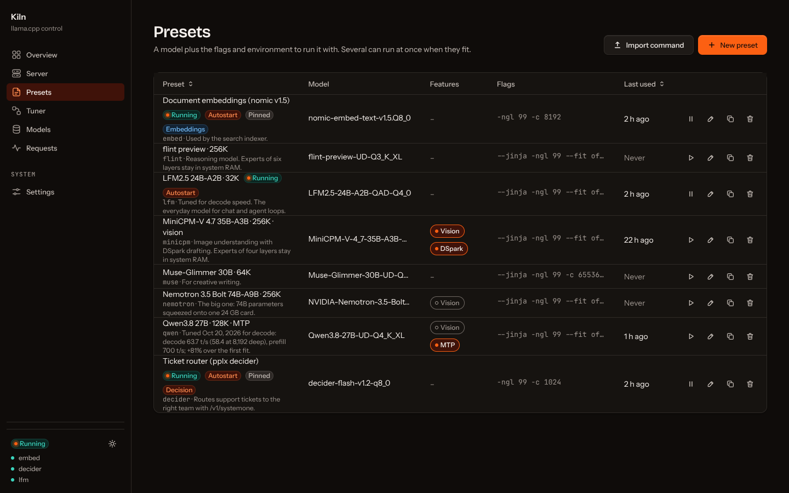

Each row shows badges (**Running**, **Autostart**, **Pinned**, and the role when it isn't Chat), the model, the
**Features** switches, the flags, and when it was last started. The buttons start or stop it, edit it, duplicate it,
or delete it. Deleting a preset keeps its run history and request statistics.

**Features** appear only for what the model can do. They are chips you can click:

| Chip | What it does |
|---|---|
| Vision | Loads the model's vision projector (`--mmproj`), found next to the model. |
| MTP | Turns on the multi-token-prediction head built into some models (`--spec-type draft-mtp`). |
| DSpark, DFlash, EAGLE-3, Draft model | Uses a draft file found next to the model for speculative decoding. |

Switching a feature off doesn't delete its flags. They stay in the preset, greyed out and skipped, so switching it
back on restores the draft length and the rest. If the preset's model is running, the toast that appears has a
**Restart** button to apply the change.

**Import command** takes a full `llama-server …` command you already use. Kiln keeps the model and flags and
drops `--host` and `--port`, because it manages those.

### The editor

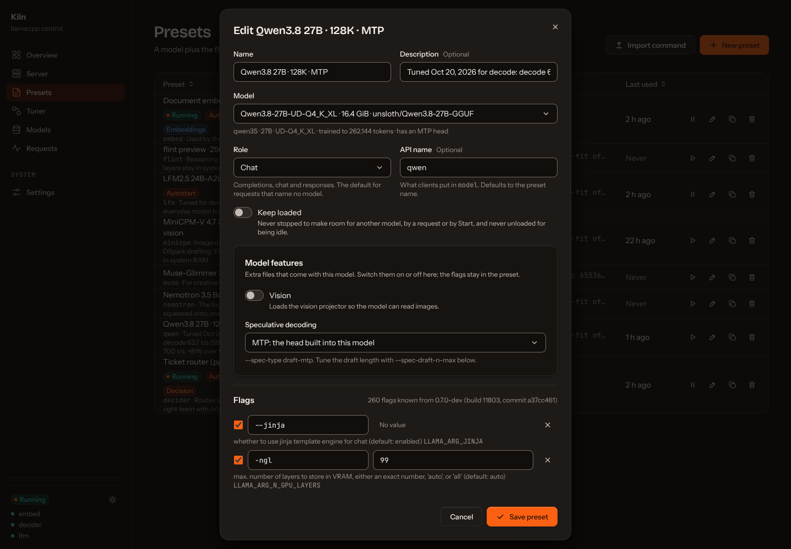

- **Model** is a library file or, with *Another path…*, a path inside the container. Below it you see the
  architecture, size, quantization, trained context, and whether the model has an MTP head.
- **Role** (Chat, Embeddings, Reranker, Decision) decides which flags Kiln adds and which API paths the model
  serves. It follows the model when you first choose one. The line under the field shows what Kiln adds.
- **API name** is what clients put in `model`. It defaults to the preset name.
- **Keep loaded** pins the preset: it is never stopped to make room for another model, by a request or by
  **Start**, and never unloaded for being idle.
- **Model features** has the Vision switch and a *Speculative decoding* choice (off, MTP, or each draft file).
- **Flags.** The editor knows every flag the compiled `llama-server` reports in `--help`, so it always matches
  the binary: it autocompletes names, offers choices for flags that have them, and shows the description and the
  environment variable under each row. A flag the build doesn't know is marked, because llama-server will
  probably refuse to start with it. The checkbox on a row skips the flag without deleting it. The buttons under
  the list add common flags with one click.
- **Environment** sets `KEY=value` variables for this preset's llama-server only, such as
  `GGML_VK_VISIBLE_DEVICES=0` or `CUDA_VISIBLE_DEVICES=0`.
- **Command** previews the command line as it stands, with a copy button.

New presets start with `-ngl 99 -fa on -c 16384 -np 1 --jinja` for chat, `-ngl 99 -c 8192` for embeddings and
rerankers, and `-ngl 99` for decision models.

## Models

Models live under `MODELS_DIR`. Kiln lists the GGUF files it finds there, including the Hugging Face cache in
`<MODELS_DIR>/hf`. Downloads go to `<MODELS_DIR>/gguf/<org>/<repo>/`.

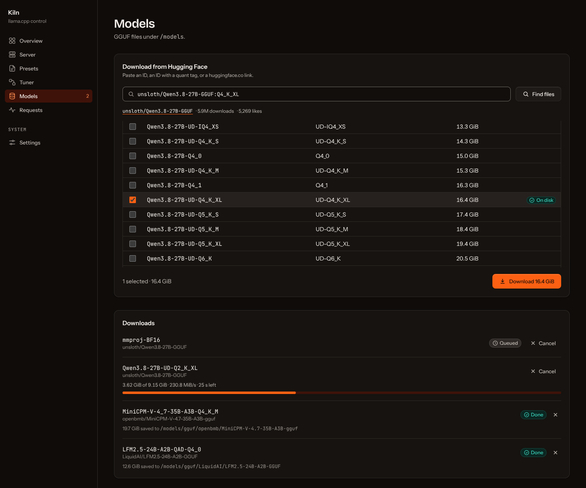

**Download from Hugging Face.** Enter `org/repo`, `org/repo:Q4_K_M` (llama.cpp's own form) or a huggingface.co
link, and press **Find files**. The repository's GGUF files appear sorted by size, with split models grouped into
one row and vision projectors and draft models labelled. The quant you named is preselected and scrolled into
view, and files you already have are marked **On disk**. Tick one or more and press **Download**.

For gated or private repositories, add a Hugging Face token in [Settings](#settings).

**Downloads.** Files download one at a time, stream to a `.part` file and resume where they left off if the
connection drops. Each row shows progress, speed and time left, with **Cancel**, **Retry** and **Remove from list**.
Kiln refuses a download that won't fit on the disk, and says how much it needs.

**Library.** Every GGUF file with its quantization, architecture and size class, trained context, size and the
date it was added.

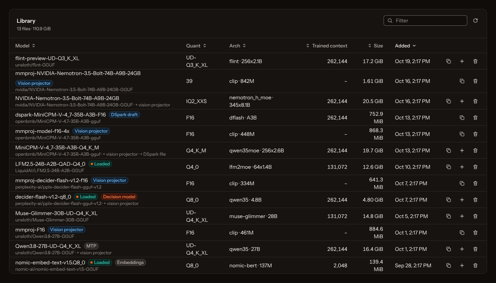

Badges show what each file is: **Loaded** (a running model is using it), **Vision projector**, a **draft** file for
speculative decoding, **Decision model**, **Embeddings**, **Reranker**, **MTP**, or **Missing parts** when a split
model is incomplete. The buttons copy the path, create a preset from the model, or delete it. Deleting removes
every file of a split model, and warns that presets using it will fail to start.

## Tuner

The tuner measures flag combinations for one model on your machine with a fixed, greedy benchmark, and saves the
winner as a preset. It is the fastest way to find the largest context that fits, or the best speed at a context
you need.

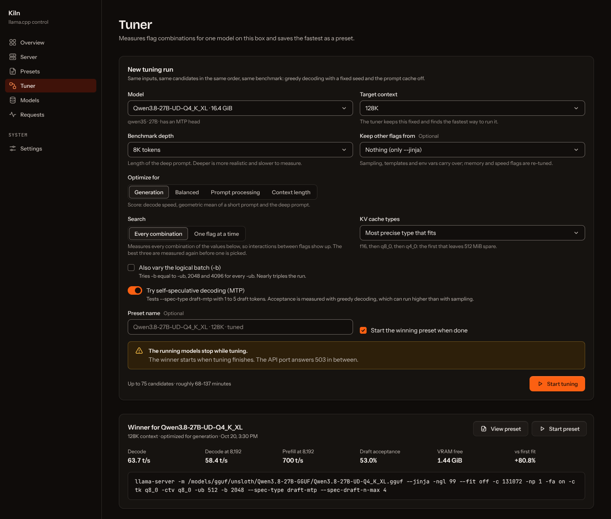

**Setting up a run.**

| Setting | What it does |
|---|---|
| Model, Target context | What to tune and the context it must hold. The tuner keeps the context fixed. |
| Benchmark depth | Length of the deep prompt. Deeper is more realistic and slower. |
| Keep other flags from | A preset whose sampling, template and environment flags carry over. Memory and speed flags are re-tuned. |
| Optimize for | *Generation*, *Balanced*, *Prompt processing*, or *Context length*, which moves weights to system RAM until the whole context fits. |
| Search | *Every combination*, or *One flag at a time* (faster, can miss combinations that only work together). |
| KV cache types | The most precise type that fits, or every type that fits. |
| MTP | For models with an MTP head, also try self-speculative decoding with 1 to 5 draft tokens. |
| Preset name | Defaults to `<model> · <context> · tuned`. |
| Start the winning preset when done | On: the winner starts when tuning ends. Off: the model that was running before comes back. |

The form shows how many candidates to expect and a rough time. **The tuner stops the running models** while it
works and the API port answers `503` in between. You get a notification when it finishes.

**Results.** A winner card shows decode and prefill speed, draft acceptance and free VRAM, the command line it
found, and buttons to open or start the preset. **Candidates** lists every trial with its stage, result, speeds and
score. Sort by any column.

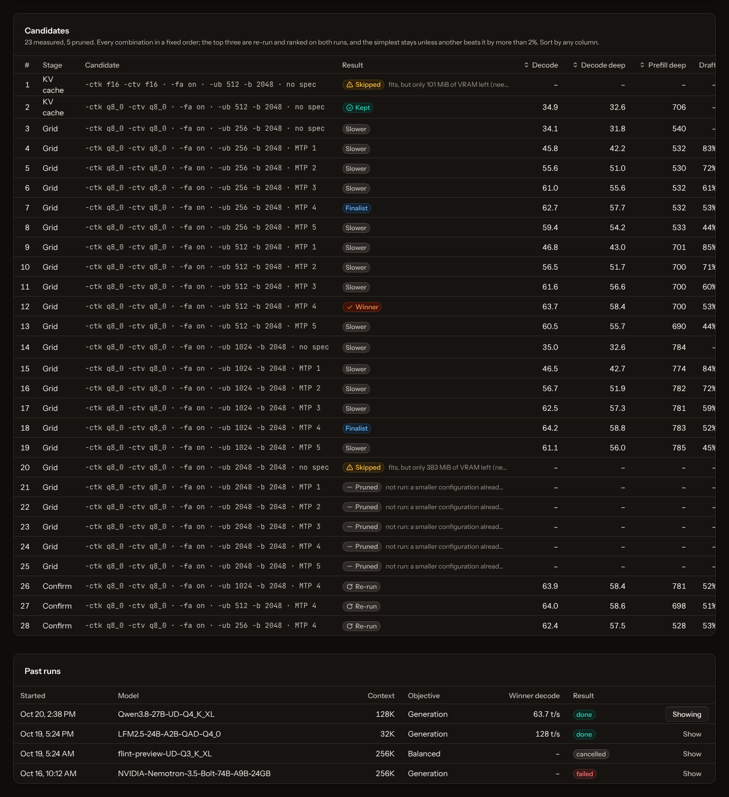

Pruned rows were skipped because a smaller configuration already didn't fit. Rows marked *Re-run* are the
second measurement of the top three, and the *Winner* is the simplest finalist unless another beats it by more than
2%. **Past runs** keeps every run, including failed and cancelled ones.

How the search works, in order, and how scores are computed, is in [TUNER.md](TUNER.md).

## Requests

Every request through the API port, newest first, 50 per page. Filter by result (**All**, **Succeeded**,
**Failed**) and by model. **Export CSV** downloads all of them.

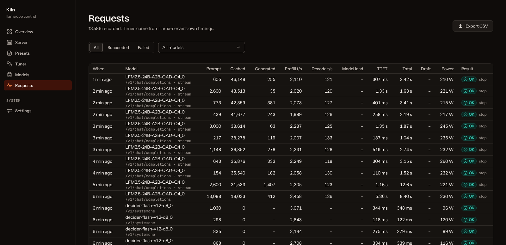

| Column | Meaning |
|---|---|
| Prompt, Cached, Generated | New prompt tokens, tokens reused from the prompt cache, and tokens generated. |
| Prefill t/s, Decode t/s | llama-server's own rates for the request. |
| Model load | Time the request waited for its model to be loaded, when it had to be. Not counted in TTFT. |
| TTFT, Total | Time to first token and wall time. |
| Draft | Share of drafted tokens accepted. |
| Power | Mean GPU power while the request ran. |
| Result | OK with the finish reason, **Aborted** when the client hung up, or the HTTP status of a failure. |

Embedding and decision requests appear too, with prompt tokens and prefill speed and no generation.

## Settings

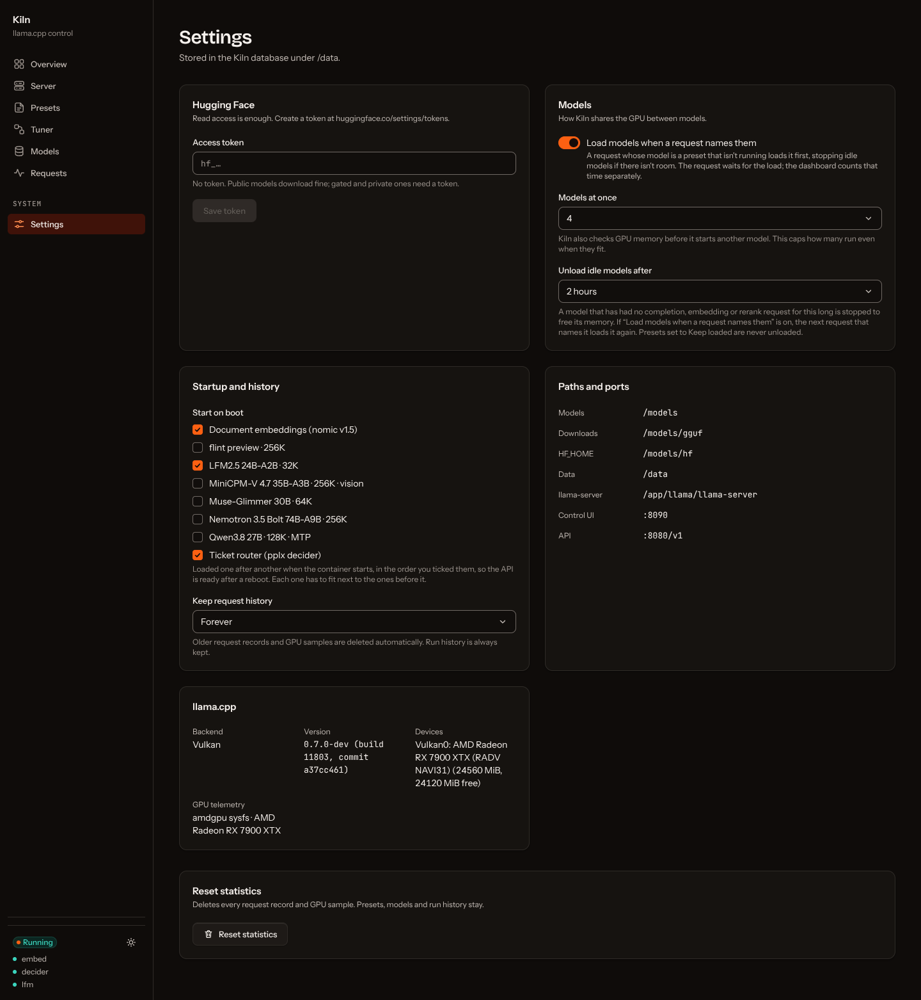

- **Hugging Face.** An access token (read access is enough) for gated and private models. The hint under the
  field says where the token in use comes from: the container's `HF_TOKEN`, the one saved here, or your
  Hugging Face CLI login in `HF_HOME`.
- **Models.** *Load models when a request names them* lets a request load a preset that isn't running, stopping idle
  models if there isn't room. *Models at once* caps how many run together even when they fit. *Unload idle models
  after* stops a model that has had no completion, embedding or rerank request for that long (never, or 15 minutes
  to 24 hours). Presets set to **Keep loaded** are never unloaded. See
  [Running several models](MULTI-MODEL.md#routing-fit-and-swapping).
- **Startup and history.** *Start on boot* lists every preset. Those you tick are loaded one after another when the
  container starts, in the order you ticked them, so each has to fit next to the ones before it. *Keep request
  history* deletes older request records and GPU samples automatically (run history is always kept).
- **Paths and ports**, and **llama.cpp**: the backend, version and devices llama-server reports, and where GPU
  readings come from.
- **Reset statistics** deletes every request record and GPU sample. Presets, models and run history stay.

## Browser extension

A toolbar button for Zen and Firefox that shows what's running and switches presets without opening the control
panel.

<table>
  <tr>
    <td>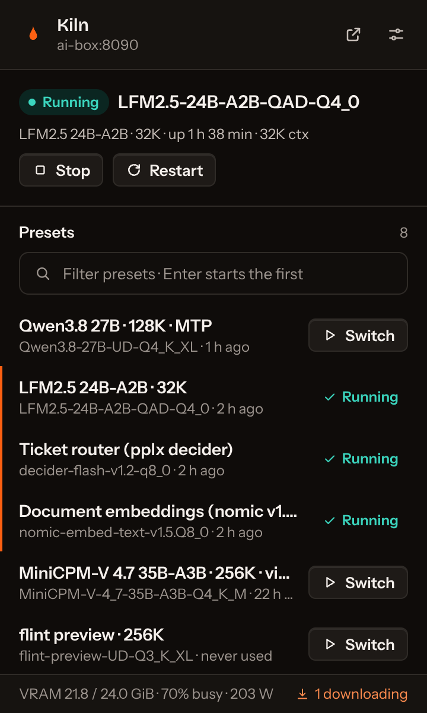</td>
    <td>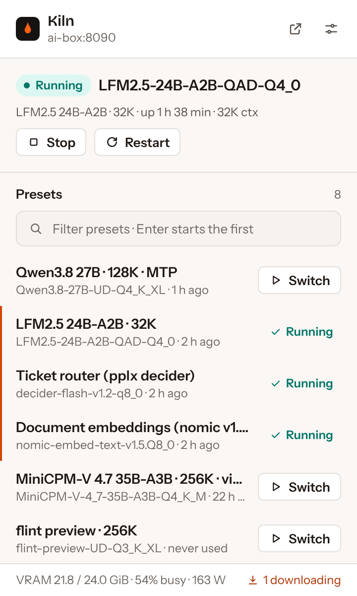</td>
  </tr>
</table>

Installing it, signing it and its settings are in [extension/README.md](../extension/README.md). It talks to the
control API described in [API.md](API.md).

## Recipes

### Run a chat model, an embedding model and a decision model together

1. Create one preset per model and set each preset's **Role**. Give each a short **API name** (`chat`, `embed`,
   `decider`).
2. Tick **Keep loaded** on the small ones so a request for another model never evicts them.
3. Start them from **Server**, smallest first. Kiln measures what each takes and uses that from then on.
4. Clients choose by name (`"model": "embed"`), and `/v1/embeddings` always goes to the embedding model.

Details, and what the Decision role does, are in [MULTI-MODEL.md](MULTI-MODEL.md).

### Let clients load models on demand

Leave **Load models when a request names them** on in Settings, and give each preset an API name. A request that
names a preset that isn't running waits while Kiln loads it, stopping idle unpinned models if it needs the room.
Streaming clients get keep-alive comments while they wait, and the load time is recorded in the **Model load**
column, not in TTFT. Set **Unload idle models after** so models you've stopped using free the GPU on their own.

### Have the right models ready after a reboot

In **Settings → Start on boot**, tick the presets in the order they should load. Tick **Keep loaded** on them too if
nothing should push them out. The container restarts on its own (`restart: unless-stopped`), so when Docker starts at boot,
the API comes back with those models loaded.

### Find the best settings for a model

Open **Tuner**, choose the model and the context you need, and leave *Optimize for* on **Generation**
(or **Context length** if the problem is fitting). Start the run, do something else, and open the preset it
saves. Run it again after a llama.cpp upgrade.

### Put Kiln on your network safely

Set `KILN_UI_PASSWORD` in `.env` and restart. Add `KILN_API_TOKEN` for scripts and the extension. Use
`--api-key` on presets you don't want strangers loading. The details are in
[Access control](CONFIGURATION.md#access-control).

### Use it from your own scripts

The control panel's own API is documented in [API.md](API.md): one call returns a status-and-presets snapshot,
one switches presets, and `GET /api/events` streams changes. The OpenAI-compatible API on port `8080` is
llama-server's, routed by Kiln.
